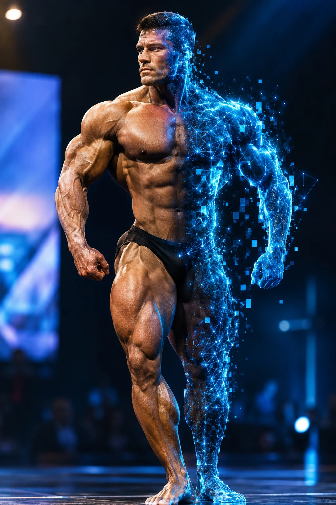
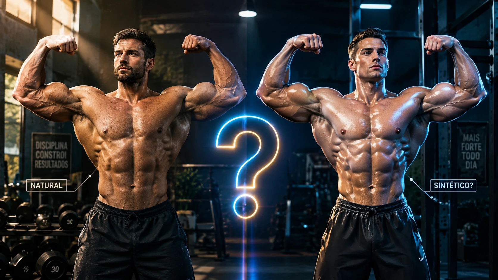
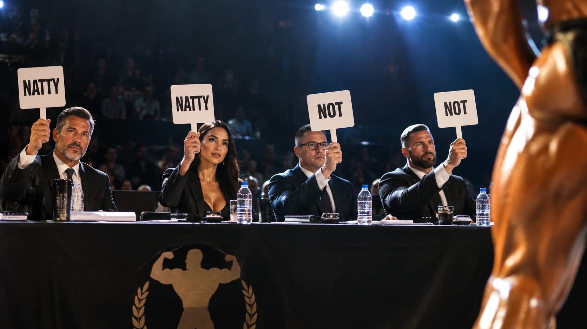
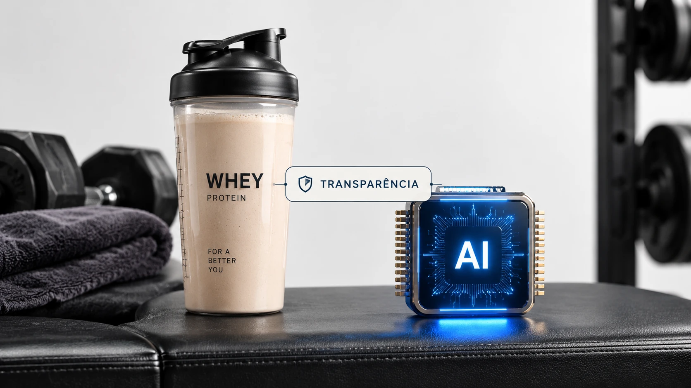
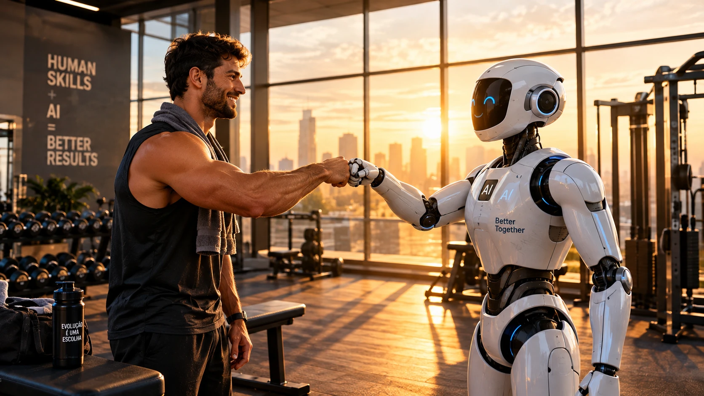

# 💪 Natty or Not?
### O Guia Definitivo para Reconhecer Conteúdo Gerado por IA

*Um e-book sobre IAs Generativas, deepfakes e olho clínico — inspirado na hype do fisiculturismo*

**Autor:** [@teixeirajoaoluz-boop](https://github.com/teixeirajoaoluz-boop) · Lab DIO **#LabDIONattyOrNot**

---

## 📚 Sumário

1. [Natty or Not? A hype que virou metáfora](#capítulo-1--natty-or-not-a-hype-que-virou-metáfora)
2. [O "shape" das IAs Generativas](#capítulo-2--o-shape-das-ias-generativas)
3. [Sinais de "Fake Natty": como identificar conteúdo de IA](#capítulo-3--sinais-de-fake-natty-como-identificar-conteúdo-de-ia)
4. [Quiz: Natty or Not?](#capítulo-4--quiz-natty-or-not)
5. [Suplemento, não substituto: IA com ética](#capítulo-5--suplemento-não-substituto-ia-com-ética)
6. [Conclusão](#conclusão)
7. [Referências](#referências)

---

## Capítulo 1 — Natty or Not? A hype que virou metáfora

No fisiculturismo, a pergunta **"Natty or Not?"** virou meme: diante de um físico impressionante, a internet inteira se transforma em perita para decidir se aquele shape é **natural** ("natty") ou se teve uma "ajudinha" química. Vídeos de análise viralizam, comentários pegam fogo e todo mundo jura que tem o olho treinado.

Agora troque o shape por uma **foto**, um **texto**, uma **voz** ou um **vídeo**. A pergunta continua a mesma:

> **Isso aqui é real… ou foi gerado por IA?**

Em poucos anos, as IAs Generativas passaram de curiosidade a ferramenta do dia a dia. Elas escrevem e-mails, criam ilustrações, narram audiobooks e produzem vídeos com avatares quase indistinguíveis de pessoas reais. O resultado é que o "natty or not" saiu da academia e entrou na nossa timeline.

Este e-book tem três objetivos:

- 🧠 **Entender** o que são IAs Generativas e o que cada tipo consegue fazer;
- 🔍 **Treinar o olhar** para reconhecer sinais de conteúdo sintético;
- ⚖️ **Usar IA com responsabilidade**, sem "fingir natty".

> 💡 **Curiosidade:** todas as imagens deste e-book foram geradas por IA — e o texto foi estruturado e revisado com a ajuda de uma IA. Ou seja: este material é, assumidamente, **"Not Natty"**. 😉

---

## Capítulo 2 — O "shape" das IAs Generativas

<!-- Imagem pendente: salve imagens/cap02.webp e descomente a linha abaixo -->
<!--  -->

IA Generativa é o ramo da Inteligência Artificial capaz de **criar conteúdo novo** — texto, imagem, áudio, vídeo, código — a partir de padrões aprendidos em grandes volumes de dados. Pense nela como um atleta que treinou com milhões de exemplos e agora consegue "executar o movimento" sozinho.

### 🏋️ Os grupos musculares da IA Generativa

| "Grupo muscular" | O que gera | Ferramentas populares |
|---|---|---|
| **Texto** (LLMs) | Artigos, roteiros, resumos, código | ChatGPT, Claude, Gemini, Copilot |
| **Imagem** | Fotos, ilustrações, artes conceituais | Midjourney, Leonardo AI, DALL·E, Stable Diffusion, Firefly |
| **Áudio / Voz** | Narração, clonagem de voz, música | ElevenLabs, Suno, Udio |
| **Vídeo / Avatar** | Vídeos a partir de texto, apresentadores virtuais | Sora, Runway, Veo, D-ID, HeyGen, Synthesia |

### ⚙️ Como funciona (versão "treino de 5 minutos")

- **Modelos de linguagem (LLMs)** preveem qual é a próxima palavra mais provável em uma sequência. Repetindo isso bilhões de vezes, produzem textos coerentes.
- **Modelos de difusão** (usados em imagem e vídeo) começam com "ruído" puro e vão removendo esse ruído passo a passo, guiados pelo seu *prompt*, até surgir uma imagem.
- **Modelos de voz** aprendem timbre, ritmo e entonação de uma voz e conseguem reproduzi-la com poucos segundos de amostra.

### 📝 O prompt é o seu "treino"

A qualidade do resultado depende muito do **prompt** — a instrução que você dá. Um bom prompt costuma ter:

1. **Contexto** — quem é o público, qual o objetivo;
2. **Tarefa** — o que exatamente deve ser gerado;
3. **Formato** — tamanho, estilo, estrutura;
4. **Restrições** — o que evitar.

> Prompt fraco: *"faça uma imagem de um fisiculturista"*
>
> Prompt forte: *"fotografia hiper-realista de um fisiculturista em uma academia antiga, luz natural entrando pela janela, lente 85mm, profundidade de campo rasa, estilo editorial de revista"*

---

## Capítulo 3 — Sinais de "Fake Natty": como identificar conteúdo de IA

<!-- Imagem pendente: salve imagens/cap03.webp e descomente a linha abaixo -->
<!--  -->

Assim como os "analistas" de shape procuram sinais reveladores, nós também podemos treinar o olhar. **Atenção:** as IAs evoluem rápido e nenhum sinal isolado é prova definitiva. Use o conjunto de pistas — e o bom senso.

### 🖼️ Imagens

- [ ] **Mãos e dedos** — dedos a mais, fundidos ou em posições impossíveis (melhorou muito, mas ainda acontece);
- [ ] **Texto na imagem** — placas, rótulos e camisetas com letras deformadas ou sem sentido;
- [ ] **Simetria suspeita** — brincos diferentes, óculos assimétricos, dentes "demais";
- [ ] **Pele perfeita demais** — textura de plástico, sem poros, brilho uniforme;
- [ ] **Fundo incoerente** — objetos que se fundem, linhas que não continuam, pessoas deformadas ao fundo;
- [ ] **Luz e sombra** — sombras apontando para direções diferentes, reflexos que não batem;
- [ ] **Metadados e credenciais** — verifique se há credenciais de conteúdo (padrão **C2PA / Content Credentials**) ou marcas d'água invisíveis como o **SynthID**.

### ✍️ Textos

- [ ] **Tom genérico e "polido demais"** — tudo correto, mas sem opinião, vivência ou detalhe concreto;
- [ ] **Estruturas repetitivas** — listas de três itens, conclusões do tipo "em resumo…", transições sempre iguais;
- [ ] **Fatos inventados** — citações, números ou referências que não existem (as famosas *alucinações*);
- [ ] **Falta de contexto local** — não menciona datas, lugares ou experiências específicas.

> ⚠️ **Detectores de texto por IA não são confiáveis** e podem acusar textos humanos injustamente. Use-os, no máximo, como mais uma pista.

### 🎙️ Áudios

- [ ] **Respiração ausente ou artificial** — falas longas sem pausa para respirar;
- [ ] **Entonação plana** — emoção que não acompanha o conteúdo;
- [ ] **Ruído de fundo "limpo demais"** ou que muda abruptamente;
- [ ] **Pedidos urgentes** — "golpe da voz clonada" costuma vir com urgência e pedido de dinheiro. Combine uma **palavra-senha** com a família!

### 🎬 Vídeos e avatares

- [ ] **Sincronia labial** — boca levemente fora do tempo do áudio;
- [ ] **Piscadas e olhar** — piscadas raras ou olhar fixo demais;
- [ ] **Bordas do rosto** — cabelo, orelhas e queixo "tremendo" ou borrados;
- [ ] **Física estranha** — objetos que atravessam outros, mãos que se deformam em movimento;
- [ ] **Origem** — quem publicou primeiro? Existe a mesma notícia em veículos confiáveis?

### 🔍 Teste com as imagens deste e-book

Todas as imagens deste e-book foram geradas por IA. Volte a elas com o checklist na mão e repare:

- **Capítulo 1:** no halteres do canto esquerdo, o "30" vira **"3C"**; o cartaz diz *"DISCIPLINA CONSTROI RESULTADOS"*, **sem o acento** de "constrói"; e o físico da direita tem a pele **brilhante e uniforme demais**, como plástico envernizado.
- **Capítulo 5:** a etiqueta "TRANSPARÊNCIA" **flutua no ar**, ligando a coqueteleira ao chip como se fosse uma interface. Isso não existe no mundo físico.
- **Conclusão:** o robô tem o selo **"AI" repetido** no peito, um impresso e outro colado ao lado, e o texto do cartaz mistura inglês com a garrafa em português.

> 💡 Repare: são detalhes pequenos. À primeira vista, todas parecem fotos profissionais. É exatamente por isso que o olhar treinado importa.

### 🧰 Ferramentas para checar

- **Busca reversa de imagens** (Google Lens, TinEye) para encontrar a origem;
- **Verificador de Content Credentials** (contentcredentials.org/verify) para ler metadados C2PA;
- **Agências de checagem** (Lupa, Aos Fatos, Estadão Verifica, entre outras) para conteúdos virais.

---

## Capítulo 4 — Quiz: Natty or Not?

Hora de testar o olho clínico! Leia cada situação e decida: **Natty 🟢** (provavelmente real) ou **Not 🔴** (provavelmente IA)? As respostas estão logo abaixo — sem espiar! 👀

1. Uma foto de um evento mostra uma faixa ao fundo com o texto *"CAMPEONATO ESTADUAL DE FISICULTRSMO 2O24"*, com letras tortas.
2. Um e-mail do seu "chefe" pede, com urgência, a compra de vales-presente e diz que não pode atender ligações.
3. Uma foto antiga de família, com granulação, uma mancha de umidade no canto e uma pessoa de olhos fechados.
4. Um vídeo de uma celebridade recomendando um investimento "garantido", com o rosto levemente borrado perto do cabelo.
5. Um artigo de blog com citações de um estudo de 2019 que você não encontra em nenhum lugar.
6. Um áudio no WhatsApp de um amigo, com barulho de trânsito, gaguejadas e um "pera aí" no meio.

<b>🔓 Ver respostas</b>

1. 🔴 **Not** — texto deformado é um dos sinais clássicos de imagem gerada por IA.
2. 🔴 **Not (golpe!)** — pode ou não ser IA, mas urgência + pedido de dinheiro + "não posso ligar" é engenharia social. Confirme por outro canal.
3. 🟢 **Natty** — imperfeições naturais (granulação, mancha, olhos fechados) são típicas de fotos reais.
4. 🔴 **Not** — artefatos nas bordas do rosto + promessa milagrosa = forte suspeita de deepfake.
5. 🔴 **Not** — referências que não existem são típicas de alucinação de LLMs.
6. 🟢 **Natty** — ruídos ambientes, hesitações e interrupções espontâneas são difíceis de simular de forma natural.

**Pontuação:**
- **6 acertos:** juiz da IFBB da IA. 🏆
- **4–5 acertos:** shape de respeito, continue treinando. 💪
- **0–3 acertos:** volta pro aquecimento e relê o Capítulo 3. 😅

---

## Capítulo 5 — Suplemento, não substituto: IA com ética

No mundo fitness, existe uma diferença clara entre **suplemento** (whey, creatina — ajudam o treino) e **atalho escondido** (o que gera o "Not Natty" não assumido). Com IA vale a mesma lógica: o problema não é usar, é **esconder** ou **usar para enganar**.

### ✅ Boas práticas

- **Seja transparente:** informe quando um conteúdo foi gerado ou editado com IA — como este e-book faz;
- **Revise sempre:** a IA erra com confiança. Você é o responsável final pelo conteúdo;
- **Respeite pessoas:** nunca use a imagem ou a voz de alguém sem consentimento;
- **Respeite direitos autorais:** verifique os termos de uso das ferramentas e não copie obras de terceiros;
- **Proteja dados:** não cole informações sensíveis (suas ou da empresa) em ferramentas públicas;
- **Use a IA para potencializar, não para substituir o aprendizado:** o "treino" (estudo, prática) continua sendo seu.

### 🚫 O que evitar

- Deepfakes de pessoas reais, mesmo "de brincadeira";
- Conteúdo que se passa por notícia verdadeira sem aviso;
- Entregar trabalhos acadêmicos ou profissionais gerados por IA como se fossem 100% autorais quando isso não é permitido.

> 🏋️ **Moral da história:** a IA é o melhor suplemento que a sua produtividade já teve. Mas, assim como no fisiculturismo, quem assume o que usa ganha respeito — quem esconde, perde credibilidade.

---

## Conclusão

A pergunta **"Natty or Not?"** nunca foi tão relevante. As IAs Generativas são ferramentas incríveis para criar, aprender e trabalhar — e justamente por isso precisamos de **olhar crítico** para consumir conteúdo e de **ética** para produzi-lo.

Resumo do treino de hoje:

1. IA Generativa cria texto, imagem, áudio e vídeo a partir de padrões aprendidos;
2. Nenhum sinal sozinho prova que algo é IA — combine pistas e verifique a fonte;
3. Seja transparente: usar IA não é problema, esconder é.

Agora é com você: **treine o olhar, use a IA a seu favor e assuma o seu shape digital.** 💪🤖

---

## Referências

- DIO — Lab "Natty or Not": <https://github.com/digitalinnovationone/lab-natty-or-not>
- Coalition for Content Provenance and Authenticity (C2PA): <https://c2pa.org>
- Content Credentials — verificador: <https://contentcredentials.org/verify>
- Google DeepMind — SynthID: <https://deepmind.google/technologies/synthid/>
- Base10 — *If You're Not First, You're Last: How AI Becomes Mission Critical*: <https://base10.vc/post/generative-ai-mission-critical/>

---

*E-book criado com IA Generativa para o Lab DIO **#LabDIONattyOrNot** — e assumidamente "Not Natty".* 😉

